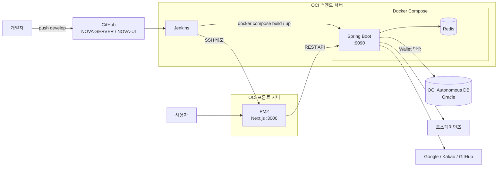

# NOVA - 공연 예매 서비스 (Backend)

> 공연 조회, 소셜 로그인, 토스페이먼츠 결제를 제공하는 공연 예매 서비스의 백엔드입니다.
> OCI(Oracle Cloud) 무료 인스턴스 위에 Jenkins 기반 CI/CD 파이프라인을 직접 구축해 운영하고 있습니다.

- Frontend Repository: [NOVA-UI](https://github.com/jaeyoung1375/NOVA-UI)
- API 문서: Swagger UI (`/swagger-ui.html`)

<br>

## 기술 스택

| 구분 | 기술 |
|---|---|
| Backend | Java 17, Spring Boot 4, Spring Security, MyBatis |
| Auth | JWT (Access / Refresh), OAuth2 소셜 로그인 (Google, Kakao, GitHub) |
| Database | Oracle Autonomous Database (OCI), Redis 7 |
| Payment | 토스페이먼츠 결제 승인 API |
| Infra | OCI Compute, Docker, Docker Compose, Jenkins |
| Frontend 배포 | Next.js, PM2 |
| 기타 | Swagger(springdoc), p6spy, Logback |

<br>

## 아키텍처



<br>

## CI/CD 파이프라인

백엔드와 프론트엔드 모두 `develop` 브랜치 기준으로 Jenkins 파이프라인을 구성했습니다.
Jenkins는 백엔드 서버에 설치되어 있으며, 프론트엔드는 SSH로 별도 서버에 배포합니다.

### Backend

```
Checkout → Inject Secret → Docker Build → Deploy (backend 컨테이너만 교체)
```

| 단계 | 내용 |
|---|---|
| Checkout | `develop` 브랜치 코드 체크아웃 |
| Inject Secret | Jenkins Credentials에 저장된 `application-secret.yml`을 빌드 시점에만 주입 (Git에는 올리지 않음) |
| Build | 멀티 스테이지 Dockerfile로 이미지 빌드 (JDK에서 bootJar 생성 → JRE 이미지로 실행) |
| Deploy | `docker compose up -d --no-deps backend` 로 백엔드 컨테이너만 재생성, Redis는 유지 |

- `disableConcurrentBuilds()`로 동시 배포 충돌 방지, 빌드 기록은 최근 10개만 보관
- DB 접속 정보, Redis 비밀번호 등은 서버의 `.env`와 Jenkins Credentials로 분리 관리
- Oracle Autonomous DB는 Wallet을 컨테이너에 읽기 전용(`:ro`) 볼륨으로 마운트해 연결

### Frontend (NOVA-UI)

```
Checkout → npm ci → Build → 릴리즈 폴더 배포 → 심볼릭 링크 교체 → PM2 Reload → Health Check (실패 시 롤백)
```

| 단계 | 내용 |
|---|---|
| Build | Jenkins 서버에서 `npm ci`, `npm run build` |
| Deploy | 빌드 결과를 `releases/{빌드번호}` 새 폴더로 전송 (실행 중인 버전은 건드리지 않음) |
| Switch | `current` 심볼릭 링크를 새 릴리즈로 교체 후 `pm2 startOrReload` |
| Health Check | `localhost:3000`을 최대 10회 확인, 실패 시 이전 릴리즈로 링크를 되돌려 자동 롤백 |

- 배포 전 현재 버전 경로를 저장해두고, 헬스체크 실패 시 바로 이전 버전으로 복구
- 릴리즈 폴더 방식이라 배포 중에도 기존 버전이 그대로 동작

<br>

## 주요 구현

### 1. JWT + Refresh Token 인증
- Access Token(30분)은 응답으로, Refresh Token(14일)은 **HttpOnly · Secure 쿠키**로 전달해 스크립트에서 접근할 수 없도록 처리
- Refresh Token은 Redis에 `refresh:{userId}` 키로 TTL과 함께 저장
  - 만료 시간이 지나면 Redis가 자동 삭제
  - 로그아웃 시 키를 삭제해 서버에서 토큰을 즉시 무효화
- Spring Security는 `STATELESS`로 설정하고, `JwtAuthenticationFilter`에서 요청마다 토큰 검증

### 2. 소셜 로그인 (Google · Kakao · GitHub)
- Spring Security OAuth2 Client 기반, 로그인 성공 시 `SocialOauth2SuccessHandler`에서 제공자별 사용자 정보를 매핑하고 회원가입/로그인 처리
- **카카오 PKCE 미지원 대응**: Spring Security가 기본으로 붙이는 `code_challenge` 파라미터를 카카오 요청에서만 제거하도록 `OAuth2AuthorizationRequestResolver`를 커스터마이징
- **GitHub 이메일 비공개 대응**: 이메일을 비공개로 설정한 사용자를 위해 별도 이메일 API를 호출하는 `GithubEmailOAuth2UserService` 구현

### 3. 토스페이먼츠 결제
- 프론트에서 결제 완료 후 전달받은 정보로 토스 결제 승인 API를 호출
- 승인 결과(결제 키, 상태, 승인 시각)와 원본 응답을 결제 이력 테이블에 저장해 추적 가능하도록 구성

### 4. 공통 처리
- `ApiResponse`로 응답 형식 통일, `GlobalExceptionHandler`와 도메인별 에러 코드로 예외 처리 일원화
- 사용자 API(`api.*`)와 관리자 API(`admin.*`) 패키지 분리
- p6spy로 실행 쿼리 로깅

<br>

## 트러블슈팅

### OCI 무료 인스턴스 메모리 부족
- **문제**: 하나의 서버에서 Jenkins, Spring Boot 빌드, Docker 이미지 빌드를 함께 수행하다 보니 무료 인스턴스 메모리가 부족해 빌드가 멈추거나 실패
- **해결**: (TODO: 인스턴스 사양/구성을 어떻게 바꿨는지 작성)
- **배운 점**: 빌드 서버와 운영 서버의 자원을 분리해서 고려해야 한다는 것

### 시크릿 관리
- **문제**: DB, JWT, OAuth 설정값을 Git에 올리지 않으면서 자동 배포가 가능해야 함
- **해결**: 민감 설정을 `application-secret.yml`로 분리해 `.gitignore` 처리하고, Jenkins Credentials에 파일로 등록해 빌드 시점에만 주입

<br>

## 개선 예정

- [ ] 백엔드도 프론트처럼 헬스체크 + 자동 롤백 단계 추가
- [ ] 블루-그린 배포로 백엔드 컨테이너 교체 시 순단 제거
- [ ] Jenkinsfile을 저장소에 포함해 파이프라인 코드화 (Pipeline as Code)
- [ ] 프론트 오래된 릴리즈 폴더 정리 (`KEEP_RELEASES` 적용)
- [ ] HTTPS 및 도메인 적용

<br>


```
